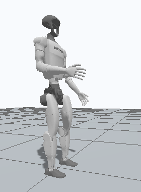
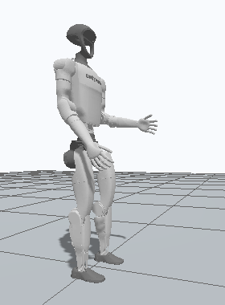

# Task 07. Диагностика движения в симуляции

Начните с симптома. **Контроллер выполнил суставную задачу** и **робот физически сделал то, что вы хотели** — разные утверждения. В этом стенде команда проходит от генератора траектории через `JointTrajectoryController` и позиционный привод Gazebo к модели с массой, инерцией и контактами. Найдите первую границу, на которой расходятся ожидание и наблюдение.

Числа ниже — ориентиры из технических прогонов G1 в ROS 2 Jazzy / Gazebo Harmonic с DART, шагом физики 1 мс и частотой контроллера 200 Гц. Это не допуски для вашего робота. Выбирайте сценарии по симптомам; проходить весь каталог подряд не требуется.

| Симптом | Что изменено в опыте | Где увидеть разницу | Первая проверка на своём роботе |
|---|---|---|---|
| **Штатный мелкий присед** | `none`: стойка → тот же старт с подготовленной траекторией | Таз опускается примерно на 1 см и возвращается; наклон мал, стопы почти неподвижны. [График](docs/assets/squat.png) | Записать свою исправную стойку и одно ограниченное движение |
| При старте корпус падает вперёд без новой команды | `torso_com`: `inertial/origin.x` торса +0.60 м | `pitch` растёт до остановки, `observe` не отправлял цель. [График](docs/assets/torso-com.png) | Проверить origin центра масс и его систему координат |
| При старте корпус падает вперёд и вбок | `link_mass`: масса левого предплечья 0.6 → 600 кг | Растут `roll` и `pitch`; сторона падения подсказывает, где смотреть. [График](docs/assets/link-mass.png) | Сверить массу каждого звена и единицы выгрузки CAD |
| При движении наклоняется весь корпус; углы суставов сходятся | `inertia`: тензор инерции левой голени ×10⁶, та же траектория | Ошибка угла почти прежняя, `pitch` заметно больше. [График](docs/assets/inertia.png) | Проверить единицы, оси и порядок компонент тензора инерции |
| При сгибании стопа уходит вбок, хотя угол колена верный | `joint_axis`: ось левого колена повёрнута на 20°, таз закреплён | Левый голеностоп смещается по `y`; action успешен в обоих опытах. [График](docs/assets/joint-axis.png) | Проверить `joint/origin` и `joint/axis` в системе сустава |
| Робот отскакивает сразу после касания пола | `spawn_bounce`: коэффициент восстановления подошв 0 → 0.9, зазор 20 см в обоих опытах | На `base_z` виден подъём после касания и повторное падение. [График](docs/assets/spawn-bounce.png) | Сверить стартовый зазор collision и свойства обеих поверхностей |
| Робот едет по полу почти без наклона | `slippery_feet`: трение подошв 0.9 → 0.02 при той же боковой силе 15 Н | `Foot XY drift` растёт, хотя `roll/pitch` почти нулевые. [График](docs/assets/slippery-feet.png) | Проверить трение пары и смотреть движение стоп вместе с контактами |
| Задание плавное, но сустав не успевает | `slow_servo`: gain позиционного привода 0.15 → 0.015, тот же `yaw_sweep` | `desired` тот же, `actual` отстаёт на переходах. [График](docs/assets/slow-servo.png) | Уточнить семантику интерфейса, ограничения, скорость обновления и модель привода |
| Сустав дрожит и повторяет колебания задания | `reference_chatter`: цель поворота чередуется около ±0.16 рад, модель `none` | Колебания уже есть в `desired`; `actual` следует за ними. [График](docs/assets/reference-chatter.png) | Записать исходные waypoints, `desired` и измерение на общей шкале времени |
| Двигается исправно, но не тот сустав | `swapped_joints`: поменяли местами имена двух локтей, значения углов остались в исходном порядке | Задание в `desired` получает правый локоть. [График](docs/assets/swapped-joints.png) | Сверить пары `joint_names[i] ↔ positions[i]` до отправки goal |

## Как читать результаты

В таблице даны два запуска для каждой гипотезы. Поднимайте свежую сцену для каждого опыта, сохраняйте шаг физики и меняйте один фактор. [Точные команды для A и B](docs/Demo_L07.md).

В PNG смотрите форму кривых, в CSV — значения и время, в JSON — настройки, статус и причину остановки. При `observe` цель движения отсутствует, поэтому tracking error может быть пустой. `Foot XY drift` оценивает смещение системы координат стопы по положению базы и углам суставов. При свободном тазе читайте его вместе с контактами. При закреплённом тазе график показывает перемещение стопы в воздухе.

Изменения модели находятся в [model.py](src/stability_lab/stability_lab/model.py), профили команд и запись обратной связи — в [experiment.py](src/stability_lab/stability_lab/experiment.py). Числа и происхождение готовых графиков доступны в [данных к графикам](docs/assets/measured-plot-provenance.json).

## Стойка и штатный присед

В двух свежих сценах `scene free none` запустите сначала `observe stand --duration 10`, затем `motion squat --duration 12 --depth 0.18`. `depth` — угол сгибания бедра, не метры. Траектория задаёт изменения hip/knee/ankle pitch `[-0.18, 0.36, -0.18]` rad с обеих сторон. В проверочном прогоне высота таза снизилась с приблизительно 0.792 до 0.782 м, затем восстановилась. Максимальная ошибка суставов была около 0.0032 rad. Смотрите высоту, наклон, движение стоп и статус вместе. Для своего робота сохраните два таких контрольных файла: удержание и небольшое движение из той же начальной позы.

## Геометрия и распределение массы

**1. `torso_com`: падает вперёд без команды.** Сравните `scene free none` и `scene free torso_com` с одинаковым `observe ... --duration 10` (`com-control`, `com-fault`). Меняется только координата `x` в `torso_link/inertial/origin`: прибавляется 0.60 м вдоль локальной оси `x` торса. Меш, масса и оси суставов прежние. В проверке `pitch` достиг примерно 0.453 rad и сработал `tilt_limit`. Для наглядного контраста в отдельной сцене с `base:=fixed fault:=torso_com` тот же испорченный робот смог выполнить мелкий присед: опору заменило закрепление. На своём роботе сначала убедитесь, что значение CoM выражено в метрах и в системе звена. Проверяйте отдельно `visual/origin`, `collision/origin` и `inertial/origin`.

**2. `link_mass`: падает вбок и вперёд.** Сравните `scene free none` и `scene free link_mass`, по `observe ... --duration 10` (`mass-control`, `mass-fault`). Масса левого предплечья (`left_elbow_link`) меняется с 0.6 до 600 кг — имитация чтения граммов как килограммов; остальные inertial поля этого звена сохранены. В проверке максимальные `|roll|` и `|pitch|` достигли 0.275 и 0.493 rad. Два угла и вид спереди лучше показывают асимметрию, чем один график высоты. На своём роботе посчитайте сумму масс и сравните парные звенья. Неподвижная картинка модели этого дефекта не выдаёт.

**3. `inertia`: наклон при движении с малой ошибкой суставов.** Сравните `scene free none` и `scene free inertia` с одинаковым `motion ... --duration 12 --depth 0.18` (`inertia-control`, `inertia-fault`). В тензоре `left_knee_link` все компоненты умножены на миллион, как при чтении кг·мм² в качестве кг·м²; масса и CoM прежние. Оба action завершились успешно и дали ошибку порядка 0.0033 rad. С неправильной инерцией `|pitch|` дошёл до 0.169 rad (9.7°); в контрольной сцене он был меньше 0.001 rad. На своём роботе проверьте единицы `кг·м²`, систему координат и значения тензора, затем повторите тот же профиль из той же позы. По одному графику наклона нельзя однозначно определить дефект инерции: здесь его выделяет парный запуск.

**4. `joint_axis`: стопа идёт вбок.** Сравните `scene fixed none` и `scene fixed joint_axis` с `motion ... --duration 8 --depth 0.18` (`axis-control`, `axis-fault`). Ось левого колена отклонена на 20° от локальной `+Y` к `+X`. В исходной прямой позе разница малозаметна; при сгибании левый голеностоп уходит вбок. В проверке по позам Gazebo (`/world/stability_lab/pose/info`) диапазон координаты `y` вырос примерно до 3.8 см, хотя максимальная суставная ошибка осталась около 0.005 rad. На своём роботе закрепите основание для кинематического теста и задайте малое движение одного сустава. Сравните ожидаемое направление перемещения дочернего звена с реальной позой; дополнительно проверьте ориентацию joint frame, а не только численный вектор оси.

## Старт и контакт

**5. `spawn_bounce`: отскакивает от пола.** Сравните `scene free spawn_drop start_paused:=true` и `scene free spawn_bounce start_paused:=true` с `observe ... --duration 4` (`drop-control`, `bounce-fault`). В обеих сценах подошвы стартуют в 20 см от одного и того же пола. `spawn_drop` — контроль приземления; в `spawn_bounce` коэффициент восстановления подошв повышен до 0.9. На [графике проверочного прогона](docs/assets/spawn-bounce.png) видно, как после первого касания таз поднялся примерно на 11 см; последующий наклон вызвал остановку. Сравнивайте отскок **после касания**, не максимум высоты за весь опыт: тот может включать старт в воздухе. При наличии откройте `*.startup.csv` — там ранняя одометрия до готовности основного наблюдения. На своём роботе проверяйте зазор collision до пола и свойства пары поверхностей; сначала сравните одинаковую высоту с разными настройками контакта, затем отдельно — разную высоту с одинаковыми настройками.

**6. `slippery_feet`: едет по полу без заметного наклона.** Сравните `scene free none start_paused:=true lateral_push:=true` и `scene free slippery_feet start_paused:=true lateral_push:=true` с `observe ... --duration 4` (`grip-control`, `slip-fault`). Боковая сила на таз одинакова, 15 Н; коэффициенты трения подошв меняются с 0.9 до 0.02. В проверке оценка смещения стоп составила около 2.19 м против 0.03 мм, а `|roll|` и `|pitch|` в обоих запусках были ниже 0.001 rad. В Gazebo смотрите стопы относительно пола; по данным проверяйте, что большой drift относится к участку с контактом. При медленном симметричном приседе без боковой силы тот же дефект почти не проявился. На своём роботе подберите малое воспроизводимое воздействие, требующее касательной силы; сравните с контрольным контактом при той же нагрузке.

## Привод и задание

**7. `slow_servo`: `actual` отстаёт от плавного `desired`.** Сравните `scene fixed none` и `scene fixed slow_servo` с `motion ... --profile yaw_sweep --duration 8` (`servo-control`, `servo-lag`). Команда поворота корпуса достигает 0.60 rad в обоих опытах; коэффициент позиционного привода Gazebo снижается с 0.15 до 0.015. На панели `Waist yaw` разница заметна при изменении угла, а оба action могут успешно завершиться. В проверке максимальная ошибка выросла с 0.0083 до 0.0888 rad. На своём роботе сначала выясните, кто исполняет команду `position`: JTC передаёт заданное положение, а физическую реакцию определяет нижний слой. Само отставание не различает низкий коэффициент, ограничение скорости/усилия и задержку доставки: нужны отдельные проверки.

**8. `reference_chatter`: колебания уже в `desired`.** В обеих сценах `scene fixed none`; сравните `motion chatter-control --profile steady --depth 0 --duration 8` и `motion chatter-fault --profile reference_chatter --duration 8`. Оба запуска используют `fault:=none`, меняется профиль `motion`. Во втором опыте меняется reference для `waist_yaw_joint`; в контроле он почти нулевой. [График проверочного прогона](docs/assets/reference-chatter.png) показывает колебания `desired` около ±0.160 rad и близкие колебания `actual` около ±0.157 rad. На своём роботе проверьте источник waypoints, единицы, timestamps и интерполяцию. Если колебания есть до привода, сначала расследуйте генератор команд, а не пытайтесь убрать их увеличением демпфирования.

**9. `swapped_joints`: движется противоположный локоть.** В обеих сценах `scene fixed none`; сравните `motion elbow-control --profile elbow_sweep --duration 8` и `motion elbow-fault --profile swapped_joints --duration 8`. В `joint_names` переставлены имена левого и правого локтей, а порядок чисел в `positions` сохранён. В контроле около 0.90 rad достигает левый локоть, в дефекте — правый; другой остаётся около 0.15 rad. `desired` и `actual` совпадают для **получившего** команду сустава. Сверьте `probe_intended_joint` с `probe_commanded_joint` в JSON и обе пары кривых `Elbow angle`. На своём роботе начинайте с малого движения одного поименованного сустава. Генерируйте имена и значения из одного упорядоченного набора пар и проверяйте на выходе реальные сообщения, а не только порядок в URDF.

Кадры из двух прогонов Gazebo во время удержания угла.

| `elbow_sweep` · левый локоть 0.90 рад | `swapped_joints` · правый локоть 0.90 рад |
|---|---|
|  |  |

## Как перенести метод на свой проект

Выберите один симптом и запишите четыре строки: **ожидали → увидели → изменили один фактор → повторили тот же тест**. Укажите единицы, время, систему координат и источник измерения. Если результат изменился, сформулируйте узкий вывод с условиями запуска. Если ничего не изменилось, это полезный результат: либо гипотеза не объясняет симптом, либо выбранное воздействие её не проверяет. Для своего робота начните с минимальной команды и заранее задайте условие остановки опыта. Пауза Gazebo ограничивает симуляцию; это не аппаратный аварийный останов.
