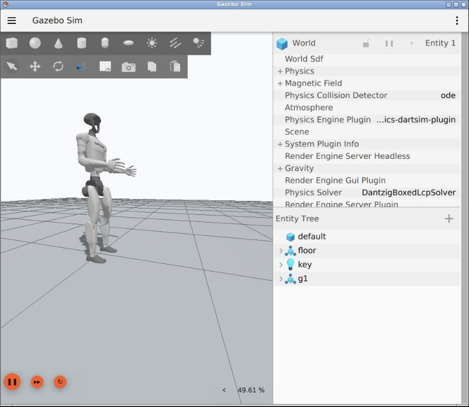

# Task 07 · Диагностика динамики и управления роботом

Практика на Unitree G1 в ROS 2 Jazzy и Gazebo Harmonic. Найдите знакомый
симптом, посмотрите измеренный результат и решите, что проверить на своей
модели. Каждый опыт можно повторить с контрольной сценой. Практику можно пройти
по готовым результатам в браузере.

- [Таблица симптомов, причин, графиков и проверок](DIAGNOSTICS.md) открывается прямо в GitHub.
- [Команды для всех сцен и контрольных прогонов](docs/Demo_L07.md) идут в порядке запуска.
- [Описание модели и лицензия Unitree](vendor/unitree_g1/README.md) сопровождают исходные URDF и STL.



Начните с одной пары прогонов. Сформулируйте гипотезу, выберите измерение
и сравните графики. Успешный результат `FollowJointTrajectory` говорит о
выполнении цели контроллера. Положение корпуса и стоп нужно оценивать отдельно.

## Запуск в Docker

В корне клона `SHAD-ROS2/tasks` один раз соберите образ, который используется
в Task 05 и Task 07. Затем запустите рабочий стол Task 07.

```bash
docker compose -f task05/compose.yaml build workspace
cd task07
docker compose up -d --pull never --wait workspace
```

Откройте [Gazebo в браузере](http://localhost:6087/vnc.html?autoconnect=true&resize=scale).
По желанию запустите браузерный редактор из `task07/`.

```bash
docker compose --profile demo up -d --pull never --wait editor
```

[Редактор Task 07](http://localhost:8087/?workspace=/workspace/l07/l07-demo.code-workspace)
открывает исходники, готовые графики в `docs/assets/` и новые записи в `evidence/`.
В [таблице команд](docs/Demo_L07.md) есть настройка двух терминалов, сборка
`stability_lab` и команды для каждой сцены.

### Первый прогон

В терминале A из `task07/` откройте shell контейнера, соберите пакет и запустите сцену.

```bash
docker compose exec workspace bash
source /opt/ros/jazzy/setup.bash
colcon build --symlink-install --packages-select stability_lab
source install/setup.bash
ros2 launch stability_lab sim.launch.py base:=free fault:=none gui:=true
```

В терминале B из `task07/` отправьте команду приседа и сохраните график.

```bash
docker compose exec workspace bash
source /opt/ros/jazzy/setup.bash
source install/setup.bash
mkdir -p evidence
ros2 run stability_lab motion --duration 12 --depth 0.18 --output "evidence/squat-$(date +%s)"
```

`--depth 0.18` задаёт угол сгибания бедра в радианах. В `evidence/`
появятся PNG, CSV и JSON. Для следующего опыта остановите A через `Ctrl+C`
и поднимите свежую сцену. По окончании выйдите из контейнеров и на хосте
выполните `docker compose --profile demo down`.

### Ubuntu 24.04 без Docker

При установленном ROS 2 Jazzy и настроенном apt-репозитории ROS можно
собрать тот же workspace из `task07/`.

```bash
sudo apt-get update
sudo apt-get install -y python3-colcon-common-extensions python3-numpy \
  python3-matplotlib python3-yaml ros-jazzy-ros-gz ros-jazzy-ros2topic \
  ros-jazzy-robot-state-publisher ros-jazzy-rviz2 ros-jazzy-tf2-ros \
  ros-jazzy-ros2-control ros-jazzy-ros2-controllers ros-jazzy-gz-ros2-control
source /opt/ros/jazzy/setup.bash
colcon build --symlink-install --packages-select stability_lab
source install/setup.bash
mkdir -p evidence
```

В обоих терминалах используйте одинаковые `ROS_DOMAIN_ID` и `GZ_PARTITION`,
отличные от других запущенных сцен. Выполните команды из таблицы прямо в
shell с подключённым ROS, а `docker compose exec workspace bash` пропустите.

## Что взять на своего робота

Меняйте по одному фактору и сохраняйте входную команду и фактическое движение.
Сравнивайте время симуляции, `desired`, `actual`, положение корпуса и контакт
стоп. Ошибки здесь включаются в симуляции. Модель G1 использует позиционный
привод и учебный монитор, который может приостановить физику Gazebo.

Оригинальный код практики распространяется по [MIT](../LICENSE.txt).
Исходные файлы Unitree сохраняют [BSD 3-Clause](vendor/unitree_g1/LICENSE).
